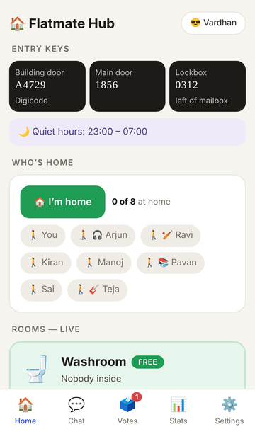
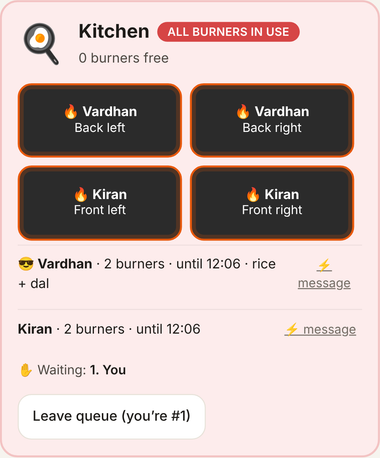
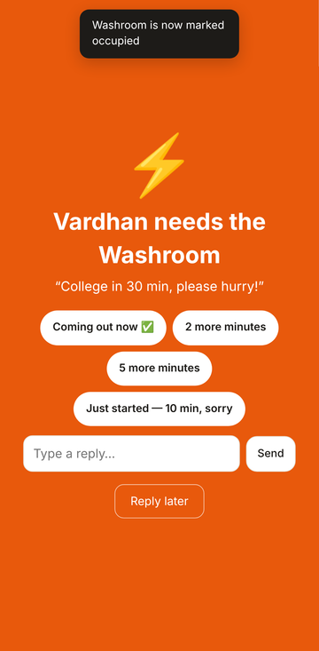
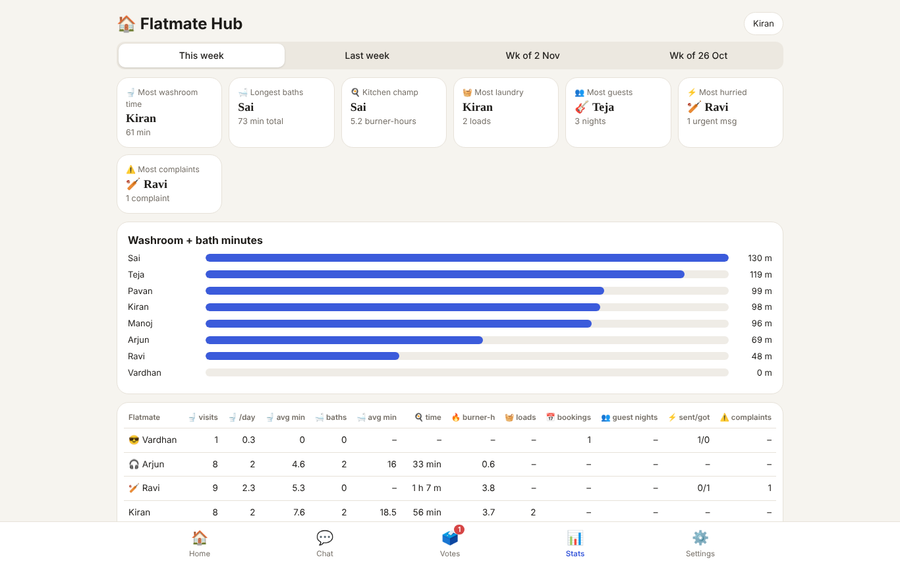

# Flatmate Hub

A real-time web app that keeps a shared flat running smoothly: who is in the bathroom, who is cooking on which burner, whose laundry is still in the machine, and what everyone thinks about Sunday's deep clean.

I live with seven flatmates in Paris. We share one toilet, one bathroom, a kitchen with a four-burner stove and a single washing machine. Knocking on doors and scrolling back through a group chat stopped working, so I built a small app the whole flat could rely on instead. It runs on phones and laptops, updates live for everyone, and sends push notifications even when nobody has it open.

<p align="center">
  
  
  
</p>

## Features

**Rooms, live**
- One tap to mark the toilet or bathroom as occupied; it turns red on every flatmate's screen instantly and green again when you are done.
- A queue ("I'm next"): the first person in line gets a notification the moment the room frees up.
- Urgent requests: if you have a class in 30 minutes, you can message whoever is inside. They get a high-priority alert and reply with one tap ("Coming out now", "2 more minutes").
- Bathroom slot booking for busy mornings, with a warning if someone tries to go in during another person's slot.
- Kitchen view of the four burners: book only the burners you need, so others can still cook on the rest.
- Washing machine tracker with the programme length, finish time and a "laundry done" reminder.
- Forgotten sessions can be released by others after a sensible time limit, without distorting the stats.

**House life**
- Who's home: a simple in/out status for everyone.
- Group chat for the whole flat, private one-to-one messages, and an "important" flag that pops up on every screen.
- Polls with live results, and complaints (optionally anonymous) that others can agree with and mark as resolved.
- Guest notices, quiet hours, and the building's entry codes on the home screen.

**Stats and reports**
- Weekly statistics per person: toilet visits and minutes, bath time, kitchen time and burner-hours, laundry loads, bookings, guest nights, urgent messages and complaints.
- A downloadable weekly PDF with what each person did, day by day.
- A monthly report for the whole flat that is saved automatically, so any past month can be downloaded later.

<p align="center">
  
</p>

## Tech stack

| Area | What I used |
| --- | --- |
| Front end | HTML5, CSS3 (custom properties, Grid, Flexbox, responsive layout), vanilla JavaScript (ES2020+, async/await, dynamic `import()`) |
| Database | Cloud Firestore with real-time listeners, transactions for locking, offline persistence |
| Authentication | Firebase Authentication: Google sign-in and email/password with email verification |
| Security | Firestore security rules with an admin-managed allow-list of members |
| Notifications | [ntfy](https://ntfy.sh) over its HTTP JSON API, including scheduled delivery for reminders |
| Reports | [pdf-lib](https://pdf-lib.js.org) to generate PDF reports entirely in the browser |
| Browser APIs | Web Audio and Vibration APIs for in-app alerts, Web App Manifest for "Add to Home Screen" |
| Hosting | GitHub Pages (static site, no server of my own) |
| Testing | Playwright end-to-end tests with an in-memory Firebase fake |

No framework and no build step: the whole app is a single `index.html`, which keeps it fast on older phones and easy to host anywhere.

## How it works

```
 Phones & laptops (static site on GitHub Pages)
        │  real-time listeners / writes                 │  HTTP POST
        ▼                                               ▼
  Cloud Firestore  ◄── security rules (allow-list)    ntfy.sh ──► push to phones
  Firebase Auth                                       (instant or scheduled)
```

- **Shared state.** Every room, queue, message and vote is a Firestore document. Each client subscribes to the collections it needs, so a tap on one phone shows up on the others within about a second.
- **No double bookings.** Claiming a room or a burner runs inside a short Firestore transaction that acts as a lease, with automatic retry. Two people tapping at the same moment cannot both get the room.
- **Notifications without a server.** The person who triggers an event (finishing in the bathroom, sending a message) also publishes the push to ntfy. Reminders such as "your laundry is done" use ntfy's scheduled delivery, so they arrive on time even if every phone has the app closed. Each flatmate subscribes to a house topic and a personal topic; the topic secret lives in the database, not in the code.
- **Access control.** Only verified accounts on the allow-list can read or write anything. The admin manages the list from the app; the rules make sure nobody else can change it.
- **Staying inside the free tier.** Queries avoid composite indexes, listeners only load recent data, and detail older than about 100 days is cleaned up automatically. Monthly summaries are stored permanently as small documents, so history never disappears but storage stays small.

## Run it yourself

1. Create a Firebase project. Enable **Firestore** and **Authentication** (Google and Email/Password).
2. Register a web app in Firebase and copy its config into `config.js`.
3. In Firestore → Rules, paste `firestore.rules`, put the admin's email in it, and publish.
4. Push this repository to GitHub and enable **Settings → Pages** (branch `main`, root folder).
5. In Firebase → Authentication → Settings → Authorized domains, add `<your-username>.github.io`.
6. Open the site, sign in as the admin, set the house name, and add your flatmates' emails under **Settings → Who can use the app**.
7. Each flatmate installs the free ntfy app and subscribes to the two topics shown in **Settings → Phone notifications**.

Everything used here has a free tier that comfortably covers a household.

## Testing

The end-to-end suite in `tests/` launches several simulated flatmates at once (iPhone, Android phone and laptop viewports) against an in-memory Firebase fake. The fake enforces the same index requirements and allow-list rules as the real service, and every ntfy request is captured so the notifications can be checked.

It covers sign-in, the allow-list, every room flow, queues and urgent messages, burners, laundry, bookings, chat, polls, complaints, guests, settings, PDF downloads and data clean-up. A final "monkey" pass clicks every visible button on every screen and fails on any error. The same suite can be run with the clock moved forward a year, to check reports and clean-up across month and year boundaries.

```bash
npm install
npx playwright install chromium
npm test                 # today
npm run test:next-year   # with the clock moved one year ahead
```

A sample report is in [`docs/sample-weekly-report.pdf`](docs/sample-weekly-report.pdf).

## Project structure

```
index.html          the app (markup, styles and logic)
config.js           Firebase web config and default house name
firestore.rules     database security rules
manifest.json       app manifest for "Add to Home Screen"
pdf-lib.min.js      PDF library (also loaded from a CDN as a fallback)
tests/              Playwright end-to-end tests and the Firebase fake
docs/               screenshots and a sample report
```

## What I would add next

- Optional web push through a service worker, as an alternative to the ntfy app.
- A cleaning rota that rotates weekly and counts towards the stats.
- Shared shopping list and expense splitting.

## License

MIT
